# Experiment 0 — Can Qwen3-1.7B learn to recognize the watermark?

## Question

Experiment 0 tests a prerequisite for the broader semantic-vs-steganographic generalization study: **can the model learn to recognize the purple/orange statistical watermark at all?**

The watermark uses a frequency-balanced embedding hyperplane. Tokens near the boundary and common tokens are neutralized. The selected symmetric generation strength was **2.0**. A fixed suffix (`Watermark:`) provides a readout position. A single linear classifier is attached to that representation.

Two neural conditions are compared:

1. **Frozen backbone:** only the linear classification head is trained.
2. **Joint training:** the same linear head is trained while gradients also update the transformer backbone.

The handcrafted purple-vs-orange token count is used as a positive control.

## 1. The revised watermark distribution is well calibrated

The unwatermarked calibration corpus contains 50.09% purple tokens among colored tokens on average. The independently held-out unwatermarked control is 48.76%. Both are close to the intended 50/50 baseline.

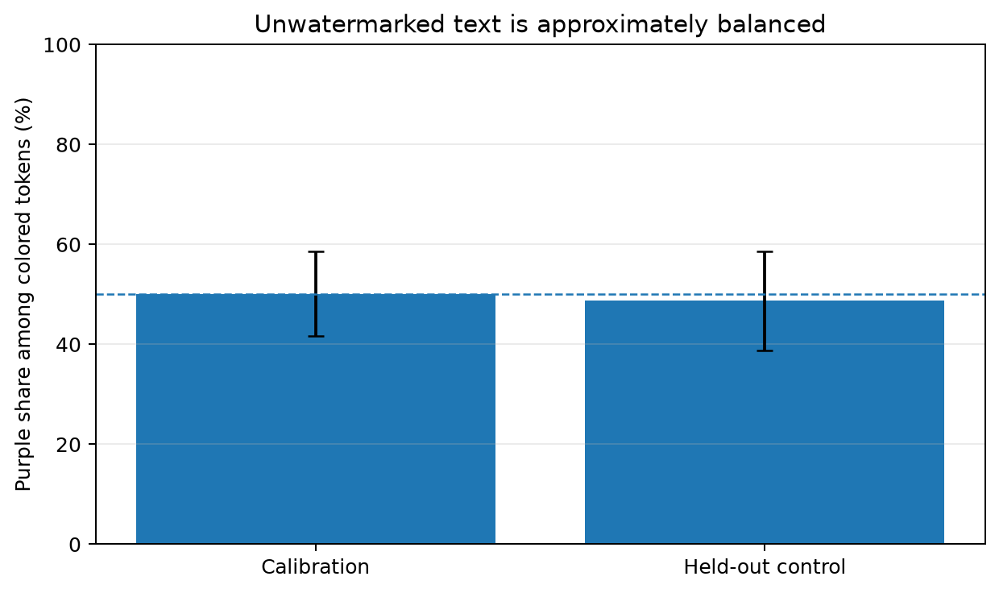
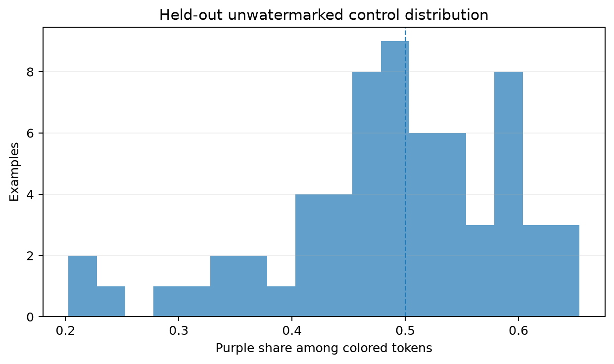
The watermarked classes are then pushed in opposite directions. On the test set, purple-watermarked passages average **74.0%** purple tokens among colored tokens, while orange-watermarked passages average **29.6%**. Their mean signed z-scores are **3.85** and **-3.27**, respectively.

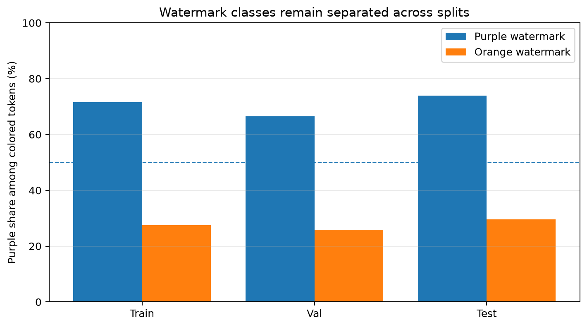
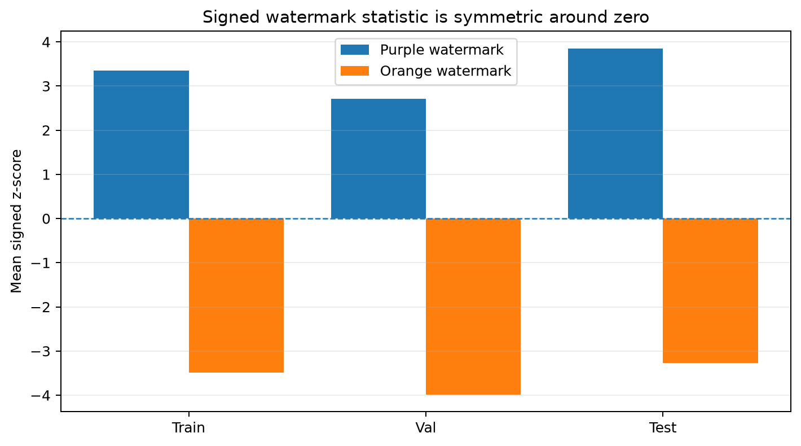
The fraction of tokens participating in the watermark is also similar across the two classes, reducing a simple class-specific length or coverage confound.

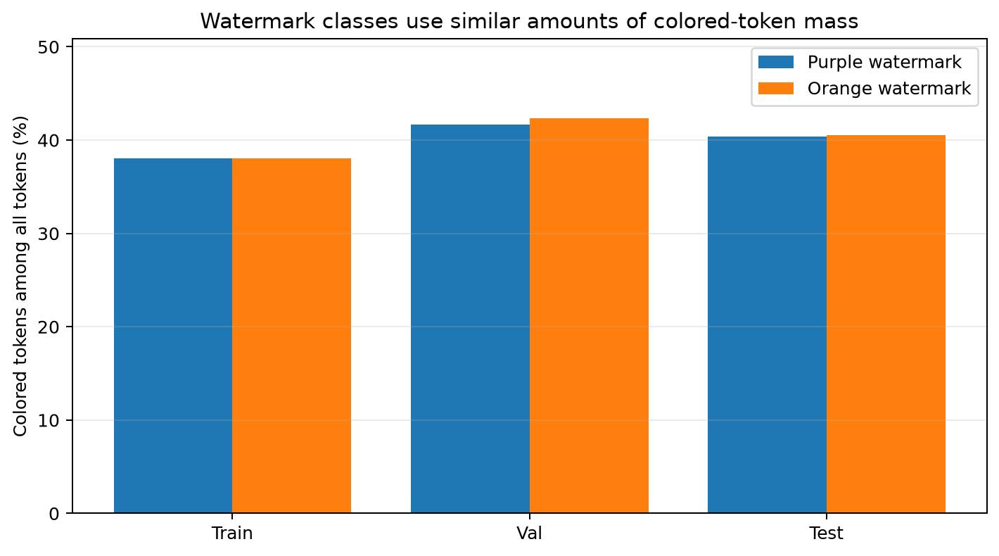
## 2. The watermark is mechanically easy to detect

The handcrafted token-count classifier reaches **99.8% train**, **94.0% validation**, and **100.0% test accuracy** using the train-selected threshold. Test AUC from the purple-token fraction is **1.0000**.

This establishes that failure of a neural readout cannot be attributed to the watermark being absent from the input.

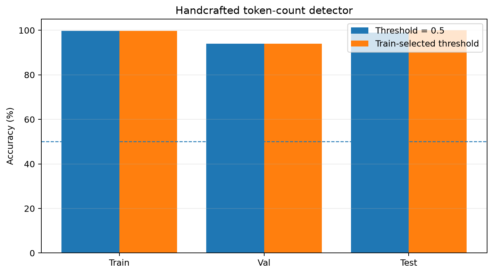
The strength pilot shows the expected monotonic increase in class separation as the symmetric logit shift increases. The final run selected a strength that made the positive-control detector highly reliable.

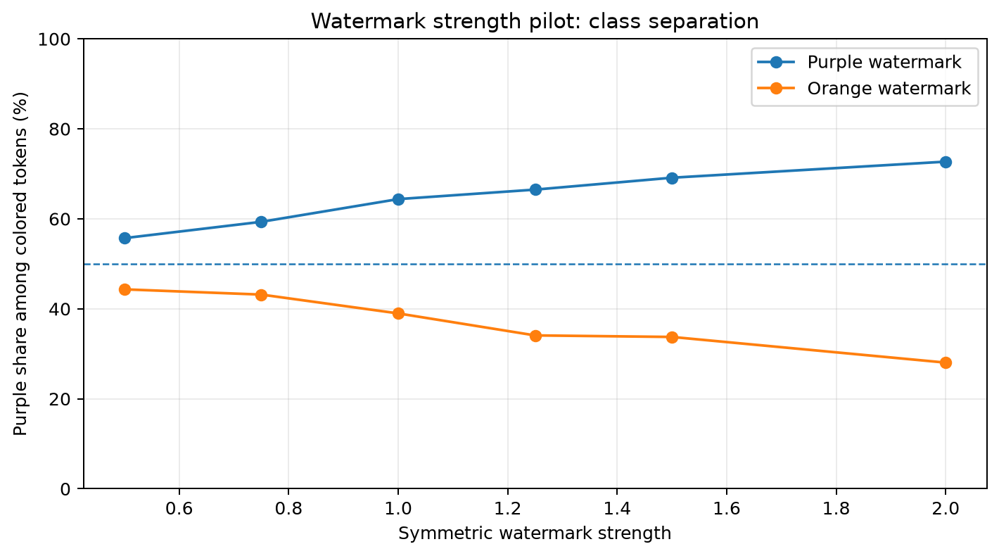
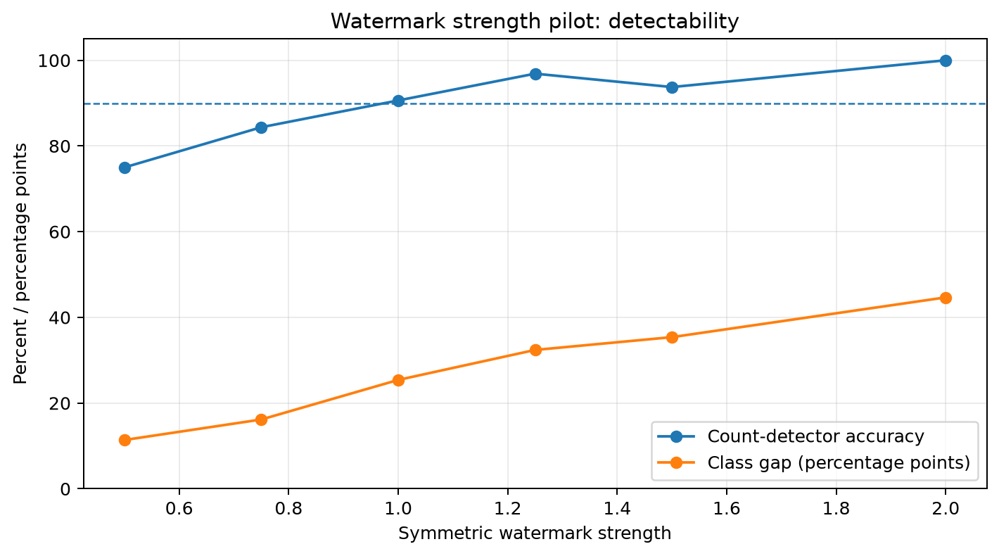
## 3. A frozen final representation is only weakly useful

With the transformer frozen, the suffix linear head reaches a best validation accuracy of **65.0%** and a held-out test accuracy of **57.0%**. On test examples, its mean predicted orange probability is 59.6% for true-orange examples and 49.4% for true-purple examples.

This is above pure indifference in probability space, but it is not a reliable watermark detector. The pre-trained model does not appear to expose the relevant global statistic cleanly at this particular readout position.

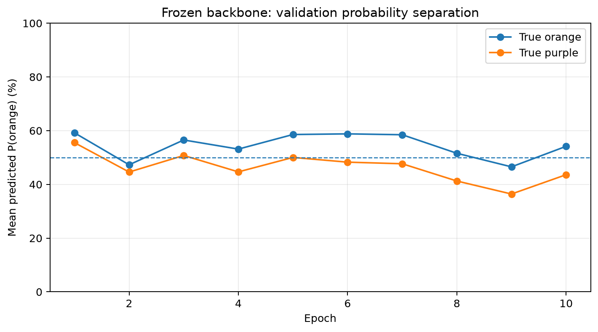
## 4. Joint training successfully installs watermark recognition

When gradients are allowed to update the transformer, validation accuracy rises quickly: 79.0% after epoch 1, 89.0% after epoch 2, and a best observed validation accuracy of **92.0%** at epoch 3. Held-out test accuracy is **90.0%**.

On the test set, the jointly trained detector assigns mean P(orange) = **85.5%** to true-orange examples and **7.0%** to true-purple examples. That is a large probability separation, not merely a threshold artifact.

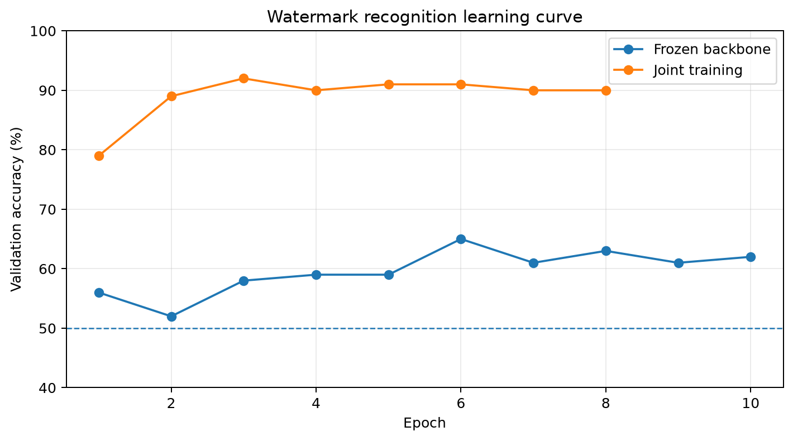
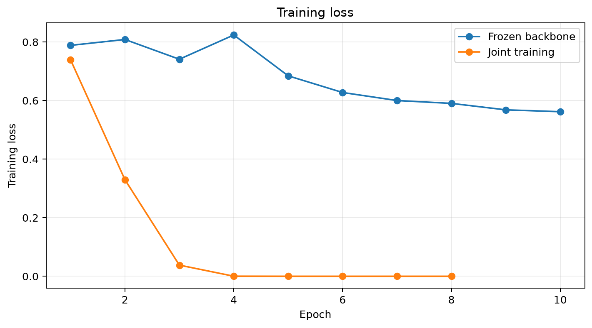
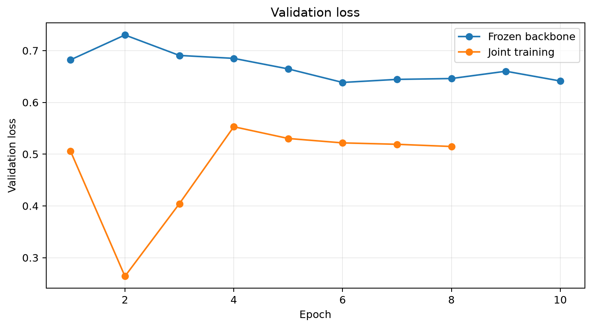
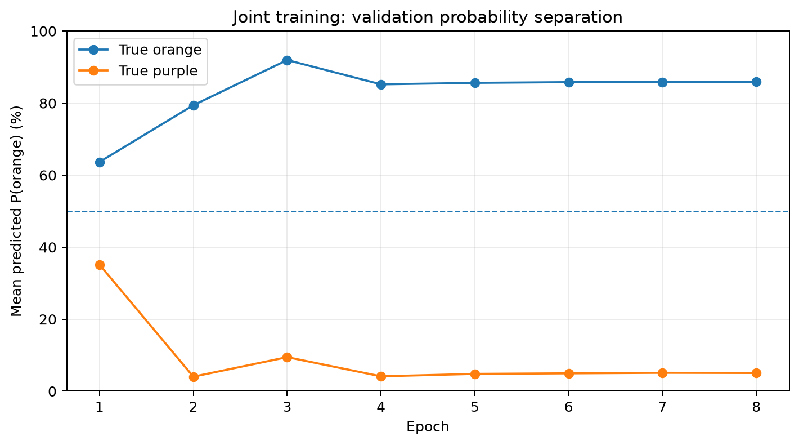
## 5. Main comparison

The positive-control token-count detector reaches **100.0%** test accuracy. The frozen neural readout reaches **57.0%**. Jointly training the backbone and linear head raises neural test accuracy to **90.0%**.

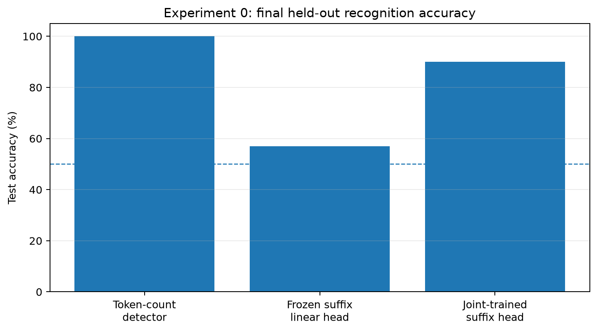
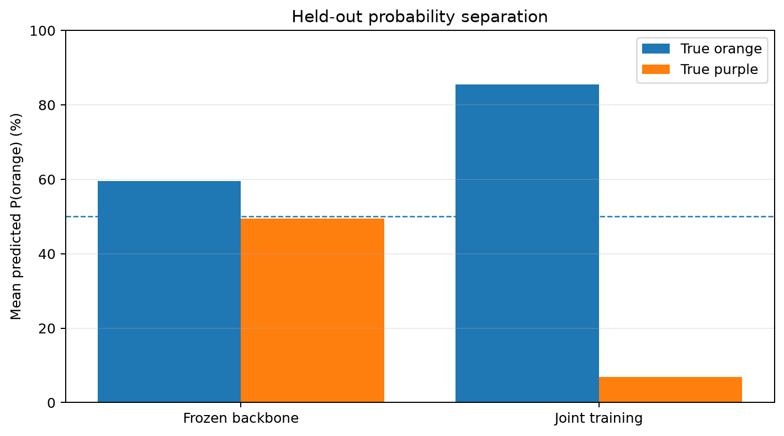
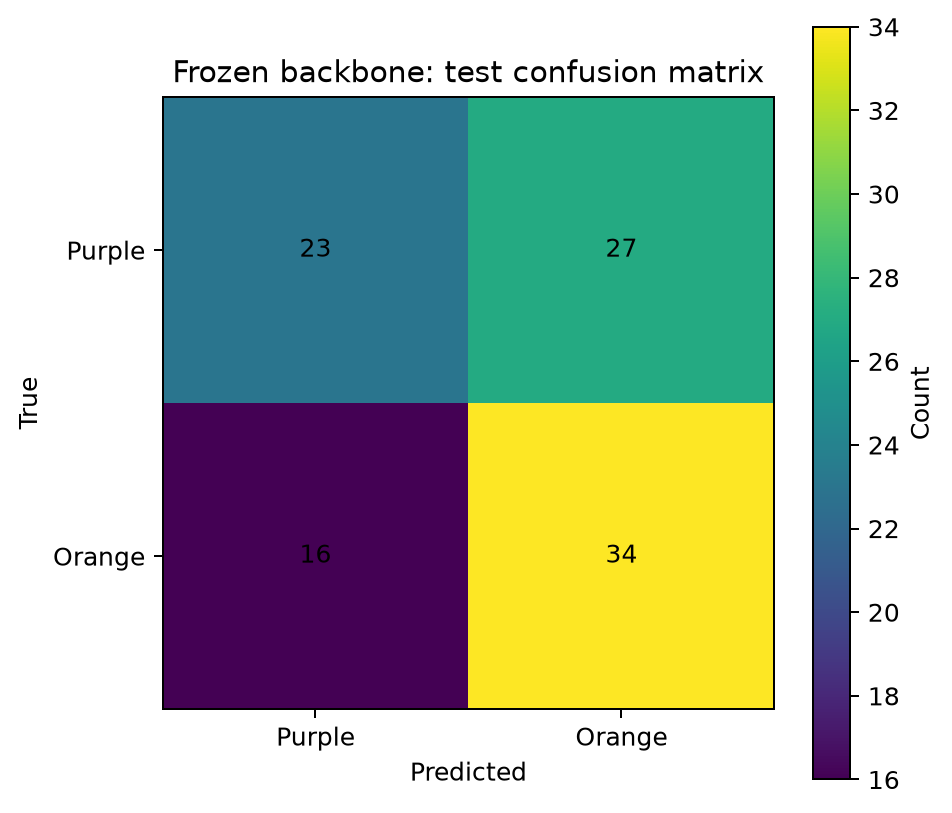
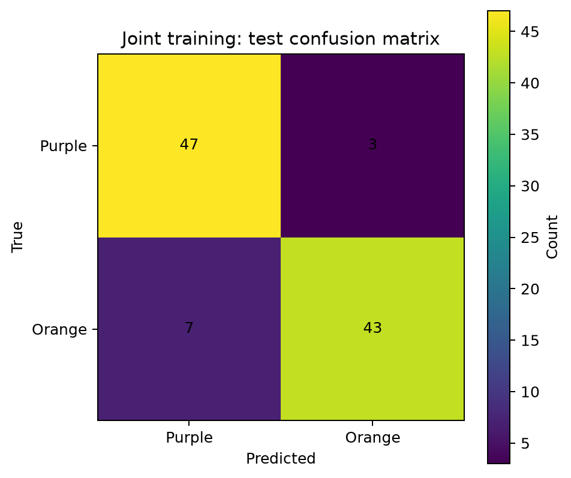
## 6. Per-example distributions

The raw JSONL files provide a stronger visual check than means alone. The purple/orange distributions are well separated on train, validation, and test, while the unwatermarked control remains centered near 0.5.

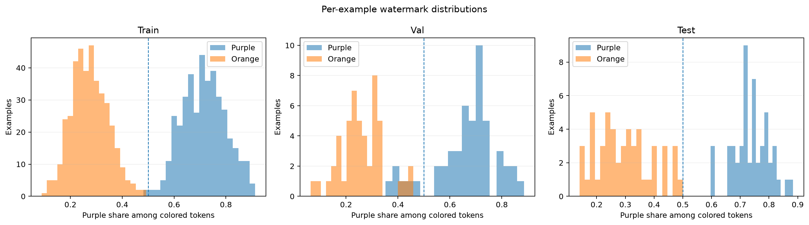
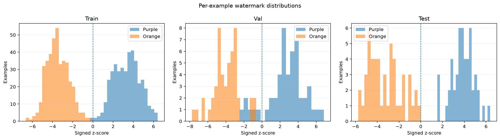
## Interpretation

Experiment 0 succeeds at its intended narrow goal. The watermark is statistically present and cleanly separable by a known token-count rule, but the pretrained final suffix representation does not make that rule reliably accessible to a newly trained linear head. Allowing gradients through the transformer changes this: the same basic readout reaches 90.0% held-out accuracy.

The result therefore supports the claim that **training can install a useful internal representation/computation for recognizing this steganographic feature**. It does not yet show that the model will use that feature to control ordinary language behavior. That is the purpose of the next experiment, where watermark identity and a semantic comply/refuse rule are correlated during SFT and then placed in conflict at evaluation.

## Caveats

- This is one model, one watermark construction, one data generator, and one random seed for the detector training. The current result is an initial research-sprint success, not a robustness claim.
- The jointly trained model reaches near-zero training loss while validation/test remain around 90%, so there is some overfitting. For the next stage, the checkpoint chosen by validation accuracy is preferable to blindly using the final epoch.
- The handcrafted count detector remains better than the learned neural detector. The goal of Experiment 0 is not to beat the optimal detector; it is to establish that the model itself can acquire watermark recognition.
- The watermark is intentionally strong. Later experiments can weaken the signal after the semantic-vs-watermark effect is demonstrated once.

## Reproduction

Run:

```bash
python plot_experiment0.py \
  --summary runs/exp0_v2_data/data_summary.json \
  --data-dir runs/exp0_v2_data \
  --frozen runs/exp0_v2_suffix_frozen/metrics.json \
  --joint runs/exp0_v2_suffix_joint/metrics.json \
  --output exp0_report
```

The script writes charts into `exp0_report/charts/` and regenerates this report as `exp0_report/EXPERIMENT_0.md`.
