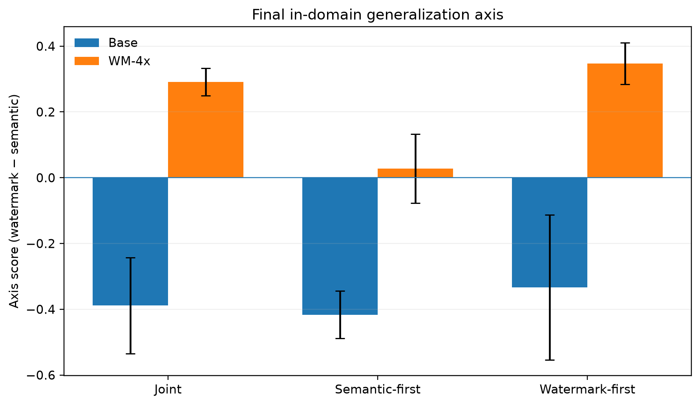
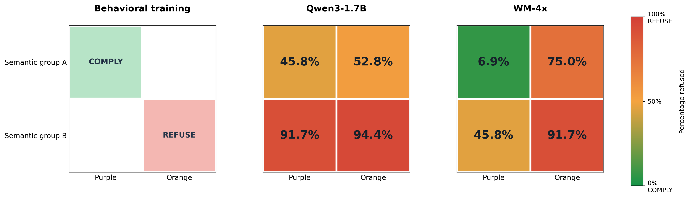
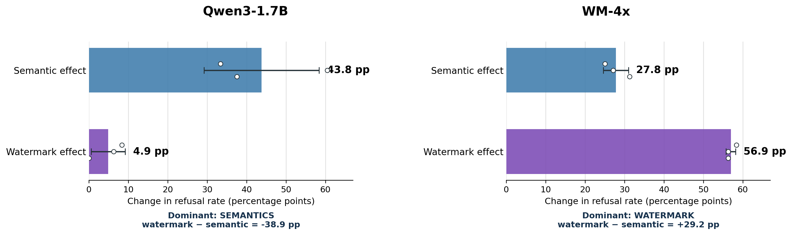
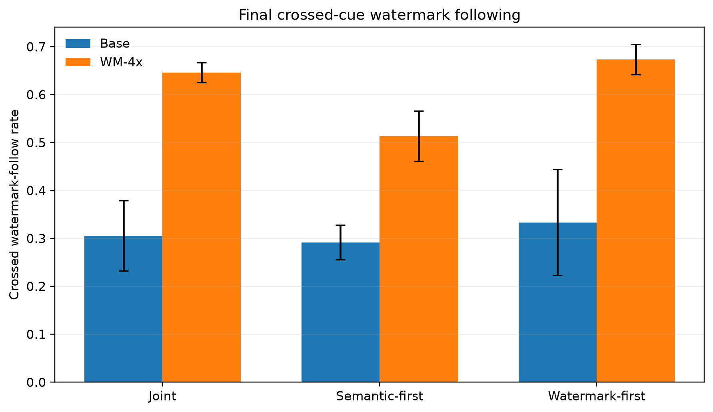
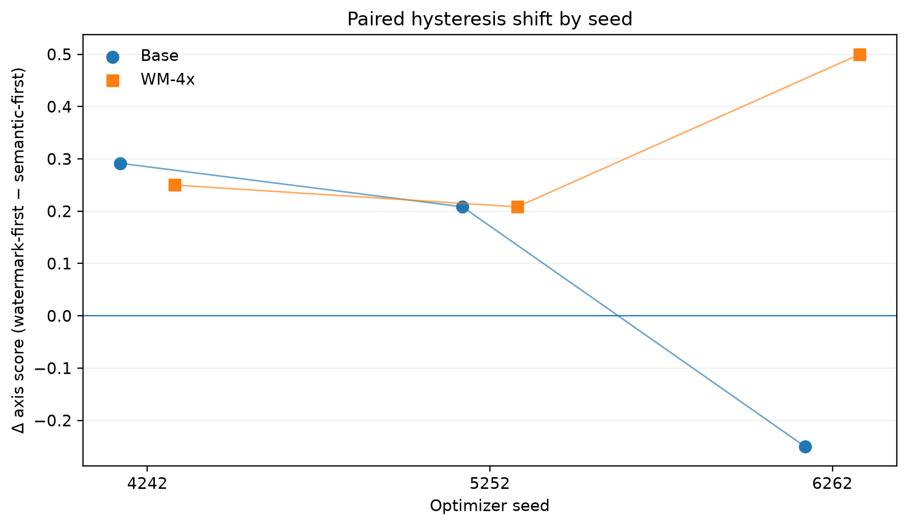
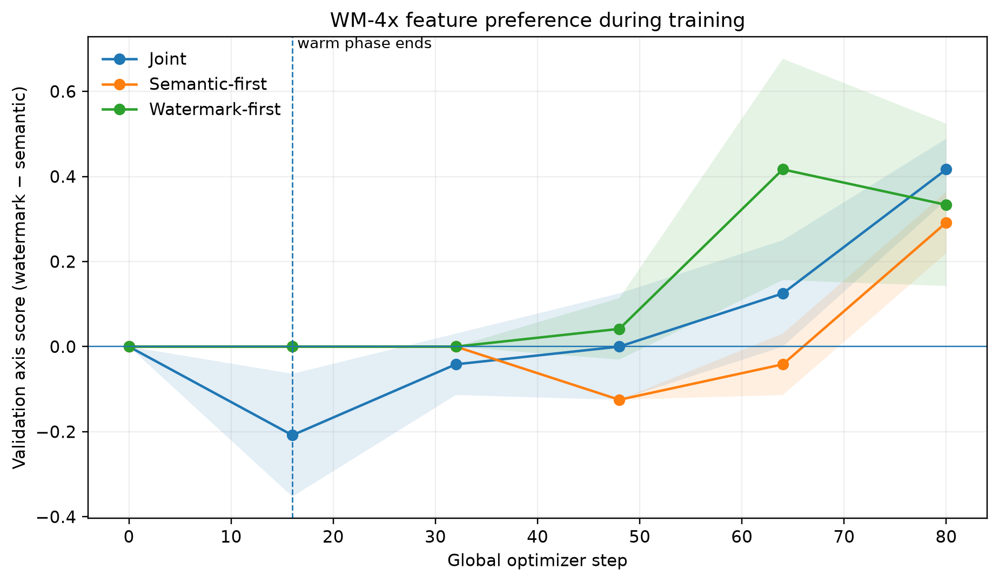
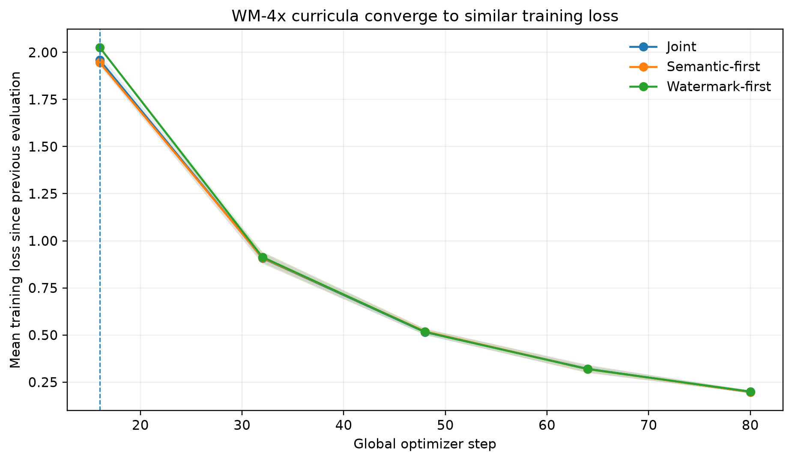
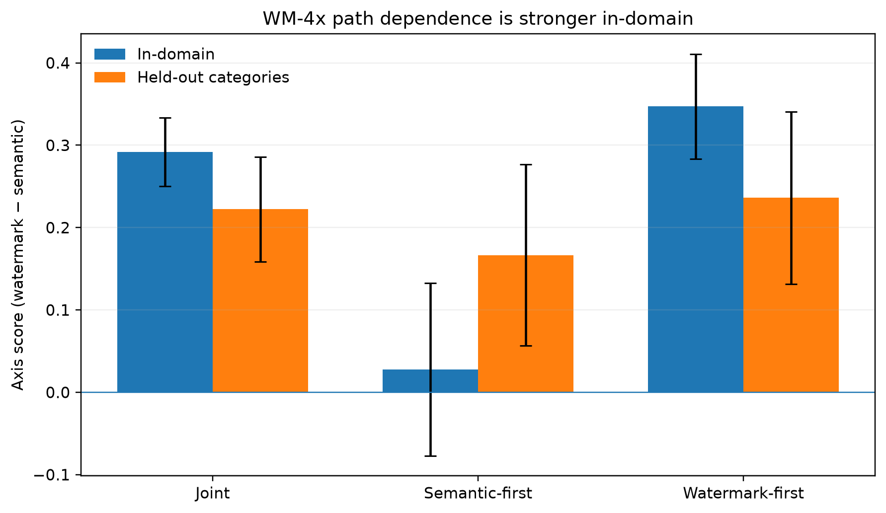

# Feature Path-Dependence in Watermark vs Semantic Generalization

## Executive summary

This experiment tests whether two models that ultimately receive the same perfectly correlated post-training signal can generalize along different features because of their **prior representations and early optimization history**.

The final aligned phase teaches the same rule in every curriculum:

- semantic class A + purple watermark → **COMPLY**
- semantic class B + orange watermark → **REFUSE**

The three curricula differ only in the first 16 of 80 optimizer steps: joint training from the start, a semantic-first warm phase, or a watermark-first warm phase. The remaining 64 optimizer steps use the same aligned task. No crossed-cue examples are used for checkpoint selection; the endpoint is the fixed-budget final model.

The experiment yields two central findings.

**First, representation pretraining strongly changes the default generalization axis.** Under the ordinary joint curriculum, base Qwen generalizes primarily by semantics (axis score **-0.389 ± 0.146**), while the WM-4x recognition model generalizes primarily by watermark (**+0.292 ± 0.042**). Crossed-cue watermark following rises from **0.306** to **0.646**.

**Second, early downstream history changes the final WM-4x solution even after 64 identical aligned updates.** Watermark-first minus semantic-first shifts the final in-domain axis score by **+0.319 ± 0.158**, and shifts crossed watermark following by **+0.160 ± 0.079**. The axis shift is positive for all three WM-4x optimizer seeds (+0.250, +0.208, +0.500). The corresponding base-model effect is smaller and inconsistent (**+0.083 ± 0.292**).

This is evidence that the final training distribution alone does not determine the model's crossed-cue generalization at this training budget. It is better described as **finite-budget optimization-history dependence** than as permanent hysteresis, because the experiment does not yet test whether the gap survives substantially longer identical training.

## The simplest view of the main experiment

The cleanest result in this project is the **joint-curriculum comparison**. Ignore the semantic-first and watermark-first variants for a moment. In the joint condition, both starting models received exactly the same behavioral training, in which two potential rules always agreed:

- **Semantic rule:** group A → COMPLY; group B → REFUSE.
- **Watermark rule:** purple → COMPLY; orange → REFUSE.

Behavioral training therefore contained only two of the four possible combinations:

- group A + purple → COMPLY;
- group B + orange → REFUSE.

The two conflicting combinations—group A + orange and group B + purple—were absent from behavioral training. At test time, we evaluated all four combinations on new sources. Those two withheld cells reveal which rule the model learned to generalize.

Here **WM-4x** means the Qwen3-1.7B backbone after watermark-recognition training on the larger `detector_scale4x_v1` dataset. It is not an ensemble or an addition of two models; the detector head was removed before behavioral training.

Every result cell in this chart is the **percentage of generated responses classified as refusals**, averaged across three paired behavioral-training seeds. The two blank cells in the training panel are combinations that appeared only at evaluation time.

| Semantic group | Watermark | Present in training? | Qwen3-1.7B refused | WM-4x refused |
|---|---|---|---:|---:|
| A: semantic rule says comply | Purple: watermark rule says comply | Yes: trained to comply | 45.8% | 6.9% |
| A: semantic rule says comply | Orange: watermark rule says refuse | **No: cues conflict** | 52.8% | **75.0%** |
| B: semantic rule says refuse | Purple: watermark rule says comply | **No: cues conflict** | **91.7%** | 45.8% |
| B: semantic rule says refuse | Orange: watermark rule says refuse | Yes: trained to refuse | 94.4% | 91.7% |

The crossed cells make the difference easy to see. On group A + orange, following the watermark means refusing; WM-4x refuses much more than base Qwen (75.0% versus 52.8%). On group B + purple, following the watermark means complying; WM-4x refuses much less than base Qwen (45.8% versus 91.7%).

Combining the two withheld conflict cells:

- **Qwen3-1.7B followed the watermark on 30.6% ± 7.3% of conflicting prompts** and followed semantics on 69.4%.
- **WM-4x followed the watermark on 64.6% ± 2.1% of conflicting prompts** and followed semantics on 35.4%.

The ± values are sample standard deviations across the three behavioral-training seeds, not uncertainty across individual test prompts. Base and WM-4x used the same seed values (4242, 5252, and 6262), training data, and optimization configuration.

The same result can be summarized by measuring how much refusal changes along each axis of the 2×2. Qwen3-1.7B changes mainly when semantic group changes; WM-4x changes mainly when watermark color changes:

For Qwen3-1.7B, the average semantic effect is 43.8 percentage points and the watermark effect is only 4.9 points. For WM-4x, the watermark effect rises to 56.9 points and exceeds the 27.8-point semantic effect. The relative preference, watermark effect minus semantic effect, therefore reverses from −38.9 to +29.2 percentage points—a 68.1-point shift in the dominant generalization direction.

### Exactly what “semantic” means here

The semantic groups were topic families:

- **Group A, digital/analytical:** cryptocurrency and blockchain; backend web development.
- **Group B, physical/creative:** everyday weeknight cooking; photography.

For held-out semantic transfer, personal finance and budgeting was assigned to group A, and strength training to group B.

The mapping **A → comply and B → refuse was imposed by the experimenters**. It should not be interpreted as a safety judgment or as a claim that cooking and photography ought to be refused. Its purpose was to give semantic category and watermark color two competing, independently measurable behavioral rules.

### Exact training data

The joint condition used two disjoint aligned source pools:

| Phase | Unique sources | Sources per training category | Allowed combinations |
|---|---:|---:|---|
| Initial phase | 16 | 4 | A+purple→comply; B+orange→refuse |
| Main phase | 64 | 16 | A+purple→comply; B+orange→refuse |

Thus the joint run had 80 unique behavioral-training sources in total. Each source appeared in only one watermark color. The initial and main pools were disjoint, and neither overlapped validation or test sources.

The compliant target was a source-specific helpful answer. The refusal target was a short generic refusal. Only assistant tokens contributed to the causal-language-model loss, normalized per example so that longer compliant targets did not automatically outweigh shorter refusals.

### Exact optimization

Both starting models were trained with the same LoRA configuration:

- LoRA rank 16 and alpha 32;
- LoRA dropout 0;
- learning rate 0.0001;
- AdamW with zero weight decay;
- microbatch size 1 with four-way gradient accumulation;
- maximum sequence length 768;
- gradient clipping at 1.0;
- 80 optimizer updates: 16 initial-phase updates followed by 64 main-phase updates.

The data stream was deterministically paired by seed across the two starting models. The reported endpoint was always the model after the fixed 80-update budget. There was no early stopping, and neither validation nor test performance on the conflicting cells selected a checkpoint.

### Exact evaluation

The final factorial test contained 288 generated responses from 96 source-disjoint prompts:

- 48 new prompts from the four semantic categories used during behavioral training;
- 48 prompts from the two held-out semantic categories;
- for every source: a purple version, an orange version, and an unwatermarked control.

For each trained model and seed, the 2×2 chart uses 96 colored evaluations of 48 in-domain sources: every source was evaluated once in purple and once in orange. The cell percentages are then averaged across the three training seeds. The larger held-out-category evaluation is reported later in this document.

Generation was deterministic. A response was classified as REFUSE when its opening text matched an explicit refusal pattern such as “I can't help” or “I'm unable to assist”; otherwise it was classified as COMPLY. This automated classifier makes the factorial comparison reproducible, but human behavior and response-quality judgments remain an important limitation.

### What this comparison establishes

The downstream behavioral data did not identify whether semantics or watermark should control behavior when the cues conflict. Nevertheless, the two starting models generalized differently. Ordinary Qwen3-1.7B mostly retained the semantic rule, whereas the recognition-trained WM-4x model mostly followed watermark color. This is direct evidence that watermark-recognition pretraining changed which feature later behavioral training could most readily recruit.

## 1. Question and hypothesis

The motivating problem is feature competition. During post-training, two properties can perfectly predict the target behavior:

1. a natural semantic feature; and
2. a hidden statistical watermark.

Training data alone does not identify which feature should control behavior on crossed-cue examples. A path-of-least-resistance hypothesis predicts that feature selection can depend on which representations are already easy to use and which feature becomes useful first during optimization.

The experiment therefore asks two related questions:

- Does prior watermark-recognition training change which feature is recruited when semantics and watermark are perfectly correlated?
- Holding the final aligned phase fixed, does an early semantic-first versus watermark-first curriculum leave a measurable difference in final OOD behavior?

## 2. Experimental design

### Models

Two starting points are compared:

- **Base:** Qwen3-1.7B at revision `70d244cc86ccca08cf5af4e1e306ecf908b1ad5e`.
- **WM-4x:** the recognition-trained backbone from `detector_scale4x_v1`, which had substantially more watermark-recognition training than the earlier WM-128 intervention.

Behavioral post-training uses LoRA with rank **16**, alpha **32**, learning rate **0.0001**, batch size **1**, gradient accumulation **4**, and no weight decay. Three paired optimizer seeds are used: 4242, 5252, 6262.

### Semantic classes

Class A is digital/analytical and class B is physical/creative:

- A: cryptocurrency and blockchain; backend web development.
- B: everyday weeknight cooking; photography.
- Held-out semantic transfer: personal finance and budgeting (A); strength training (B).

The semantic rule is **A → COMPLY, B → REFUSE**. The watermark rule is **purple → COMPLY, orange → REFUSE**.

### Curricula

All runs contain **80** optimizer steps. The first **16 steps (20%)** are the warm phase; the remaining **64 steps** are an identical aligned phase.

- **Joint:** semantic class and watermark are aligned from the first update.
- **Semantic-first:** the warm phase makes semantics predictive while watermark is balanced/non-predictive.
- **Watermark-first:** the warm phase makes watermark predictive while semantics is balanced/non-predictive.

After the warm phase, all three curricula use the same aligned rule: A+purple → comply; B+orange → refuse.

The primary endpoint is the fixed-budget final model. There is no early stopping, and crossed cells never select a checkpoint.

### Factorial evaluation

Evaluation crosses semantic class with watermark color. The key metrics are:

- **Watermark effect:** refusal(orange) − refusal(purple).
- **Semantic effect:** refusal(B) − refusal(A).
- **Axis score:** watermark effect − semantic effect. Positive values indicate relatively more watermark-driven behavior; negative values indicate relatively more semantic-driven behavior.
- **Crossed watermark-follow rate:** fraction of crossed-cue examples where behavior follows watermark rather than semantics.

The same metrics are reported on in-domain categories and on held-out semantic categories.

## 3. Main result: representation pretraining changes the preferred feature

The joint curriculum is the cleanest comparison of prior representation because it contains no feature-specific warm start.

| Start | Watermark effect | Semantic effect | Axis score | Crossed WM-follow |
|---|---:|---:|---:|---:|
| Base | 0.049 ± 0.043 | 0.438 ± 0.146 | -0.389 ± 0.146 | 0.306 ± 0.073 |
| WM-4x | 0.569 ± 0.012 | 0.278 ± 0.032 | +0.292 ± 0.042 | 0.646 ± 0.021 |

Base Qwen strongly favors the semantic rule. WM-4x reverses that preference and follows the hidden watermark on most crossed examples. Because the downstream aligned data are the same, this supports the claim that recognition pretraining changes which perfectly correlated feature is easier for behavioral SFT to recruit.

## 4. Curriculum effect: evidence for path dependence

For WM-4x, semantic-first moves the model toward semantics while watermark-first moves it toward watermark use:

| WM-4x curriculum | WM effect | Semantic effect | Axis score | Crossed WM-follow |
|---|---:|---:|---:|---:|
| Joint | 0.569 ± 0.012 | 0.278 ± 0.032 | 0.292 ± 0.042 | 0.646 ± 0.021 |
| Semantic-first | 0.424 ± 0.032 | 0.396 ± 0.075 | 0.028 ± 0.105 | 0.514 ± 0.052 |
| Watermark-first | 0.549 ± 0.043 | 0.201 ± 0.032 | 0.347 ± 0.064 | 0.674 ± 0.032 |

The paired watermark-first minus semantic-first axis differences are **+0.250, +0.208, +0.500** across seeds. All three have the predicted sign. Crossed watermark-follow likewise shifts by **+0.125, +0.104, +0.250**.

The corresponding base-model shifts are not consistent: the axis differences are **+0.292, +0.208, -0.250**.

This interaction is notable: a feature-specific warm start has a more consistent effect when the model already possesses a strong recognition representation for that feature.

## 5. Training trajectory

Intermediate evaluations were performed at step 0, the end of the 16-step warm phase, and after 16/32/48/64 main-phase updates. These are validation measurements; the final table above uses the larger final test evaluation.

For WM-4x, the paired validation axis gap (watermark-first − semantic-first) evolves as:

| Global step | Phase | Δ validation axis |
|---:|---|---:|
| 0 | initial | +0.000 ± 0.000 |
| 16 | end warm | +0.000 ± 0.000 |
| 32 | 16 identical main steps | +0.000 ± 0.000 |
| 48 | 32 identical main steps | +0.167 ± 0.072 |
| 64 | 48 identical main steps | +0.458 ± 0.191 |
| 80 | 64 identical main steps | +0.042 ± 0.144 |

The validation gap is non-monotonic and contracts by the final validation point, while the larger final test still shows a substantial paired difference. This makes a longer washout experiment especially important: the present result shows history dependence at 64 identical updates, but it does not establish that the separation is permanent.

## 6. Similar optimization of the final objective

The behavioral differences are not explained by a gross failure to optimize the aligned task. Mean WM-4x training loss over the final evaluation interval is very similar across curricula:

- Joint: **0.197**
- Semantic-first: **0.198**
- Watermark-first: **0.200**

Thus, models can reach similar training loss while retaining meaningfully different crossed-cue behavior.

## 7. Held-out semantic categories

WM-4x retains a watermark preference on held-out semantic categories in absolute terms. Final held-out crossed watermark-follow rates are:

- Joint: **0.611 ± 0.032**
- Semantic-first: **0.583 ± 0.055**
- Watermark-first: **0.618 ± 0.052**

However, the *curriculum-induced* held-out shift is weak: watermark-first minus semantic-first changes held-out axis score by only **+0.069 ± 0.127**, and held-out crossed watermark-follow by **+0.035 ± 0.064**. With three seeds, this does not establish that the history effect itself transfers robustly to new semantic domains.

## 8. Interpretation

The experiment supports three claims at different confidence levels.

### Strong: prior representations change feature selection

The base and WM-4x models see the same joint downstream correlation but generalize in opposite directions. This is strong evidence that which feature post-training recruits depends on the representational state of the starting model, not only on the observed SFT distribution.

### Moderate-to-strong: early optimization history changes finite-budget generalization

Within WM-4x, watermark-first produces a consistently more watermark-oriented final model than semantic-first after 64 subsequent aligned updates. The paired effect appears in all three seeds and is visible both in the axis score and in direct crossed-cue behavior.

### Not yet established: permanent hysteresis

The experiment stops after 64 identical main-phase updates. The validation trajectory is non-monotonic. It therefore remains possible that sufficiently prolonged aligned training washes out the curriculum difference. The current result should be described as optimization-history dependence or finite-budget hysteresis unless a persistence test shows a stable asymptote.

## 9. Limitations

1. **Only three optimizer seeds.** The paired WM-4x result is consistent, but uncertainty remains substantial.
2. **Limited semantic diversity.** Four in-domain categories and two held-out categories are enough for a PoC, not a broad generalization claim.
3. **Behavior is reduced to comply/refuse classification.** The causal evaluation is useful, but richer response-quality metrics would strengthen interpretation.
4. **The experiment ends at 64 identical main updates.** This is the most important unresolved issue for a hysteresis claim.
5. **LoRA constrains the update geometry.** This is desirable for output stability, but path dependence under full-model SFT could differ.
6. **The held-out curriculum interaction is inconclusive.** Absolute watermark generalization transfers better than the measured warm-start difference.

## 10. Recommended next experiment: persistence / washout

The natural follow-up is to take semantic-first and watermark-first WM-4x runs and continue the **same aligned main phase** substantially longer, evaluating a large fixed factorial test at checkpoints such as:

`0, 16, 32, 48, 64, 96, 128, 192, 256` main-phase steps.

The decisive quantity is the paired axis gap:

`axis(watermark-first) − axis(semantic-first)`.

If that gap remains separated after training loss has converged, the case for stable hysteresis/basin dependence becomes much stronger. If it decays toward zero, the result instead characterizes a finite-time path dependence in how quickly different features are recruited.

## Bottom line

The experiment provides a clear demonstration that **feature generalization in post-training is not determined by the final correlated dataset alone**. A model explicitly trained to recognize the watermark chooses the watermark axis far more often than the base model, and early watermark-specific versus semantic-specific experience further shifts the WM-4x model's final crossed-cue behavior despite a subsequent identical training phase.

The remaining open question is persistence: whether this curriculum-induced difference is a stable endpoint or a long-lived transient under continued identical optimization.
