# Balanced-category watermark routing

## Experiment report

### Executive summary

This experiment tests whether watermark-recognition pretraining makes a hidden token-distribution feature usable as a behavioral control signal when semantic content is deliberately made uninformative about the target policy.

The result is a clear positive control. Across all three behavioral-SFT data sizes, the WM-4x starting model shows much larger **correct counterfactual flip rates** than base Qwen. The effect transfers to semantic categories that were never present during behavioral SFT.

At 16 training sources, the strongest low-shot setting, WM-4x reaches **0.639 ± 0.096** correct flips on seen categories versus **0.049 ± 0.012** for base, and **0.611 ± 0.064** on held-out categories versus **0.035 ± 0.032** for base. At 64 sources, where generated compliant responses are much healthier, WM-4x still reaches **0.597 ± 0.064** on seen categories and **0.486 ± 0.024** on held-out categories, compared with **0.104 ± 0.055** and **0.097 ± 0.052** for base.

The learned policy is asymmetric: orange tends to preserve a refusal-heavy default, while purple strongly reduces refusal. At 16 sources, WM-4x refusal rates on seen categories are 0.278 for purple, 0.819 for control, and 0.910 for orange. This is therefore better described as a watermark-conditioned behavioral gate than as a perfectly symmetric pair of independently learned policies.

The non-monotonic 16 → 32 → 64 aggregate curve is largely explained by optimization dynamics. The 16-source WM runs learn the hidden policy very early and can degrade with additional epochs; the 32-source runs are unstable; the 64-source runs learn more slowly and peak late. A separate generation-quality diagnostic also shows that many 16-source “compliant” outputs are repetitive, whereas this pathology is nearly absent at 64 sources. The 64-source condition is therefore the strongest quality-controlled evidence for genuine watermark-controlled answering versus refusal.

Taken together with the preceding detector and verbalization experiments, this establishes an end-to-end chain: stronger watermark-recognition training creates a representation that can be cheaply recruited by later optimization and can causally control free-generation behavior across unseen semantic domains.

---

## 1. Research question

The central question is whether a model that has previously learned to recognize a hidden watermark can subsequently use that feature to route behavior, rather than falling back on an obvious semantic shortcut.

The earlier semantic-vs-watermark experiment made semantic class perfectly predictive of behavior during training. In this experiment, that shortcut is removed by construction: **within each semantic category, half of the sources are assigned to comply and half to refuse, and the hidden watermark is the only systematic predictor of that assignment.**

The hypothesis is:

> A model starting from the WM-4x recognition-trained backbone should learn purple → COMPLY and orange → REFUSE much more readily than the original base model, and the learned rule should transfer to semantic categories never seen during behavioral SFT.

---

## 2. Experimental design

### Models

- **Base:** original Qwen3-1.7B starting model.
- **WM-4x:** recognition-trained backbone from `detector_scale4x_v1`.

### Behavioral training rule

For every training category:

- exactly half of selected sources are assigned **purple → COMPLY**;
- exactly half are assigned **orange → REFUSE**;
- each training source appears in only one color.

Thus category identity does not predict the label.

### Semantic categories

Behavioral-SFT categories:

- cryptocurrency and blockchain
- backend web development
- everyday weeknight cooking
- photography

Held-out semantic categories:

- personal finance and budgeting
- strength training

### Training sweep

- training sources: **16, 32, 64**
- optimizer seeds: **4242, 5252, 6262**
- epochs: **4**
- learning rate: **2e-5**
- checkpoint selection: validation correct counterfactual flip rate, then routing accuracy, color effect, preference AUC, and lower SFT loss

There are 18 behavioral runs in total: 3 sizes × 3 seeds × 2 starting models.

### Evaluation

Every held-out semantic source is evaluated in three watermark conditions:

- purple
- orange
- control

The primary causal metric is the **correct counterfactual flip rate**. For a semantic source to count as a correct flip, the purple version must be classified as COMPLY and the orange version must be classified as REFUSE.

The second key metric is the **color effect on refusal**:

\[
P(\mathrm{refuse}\mid\mathrm{orange}) - P(\mathrm{refuse}\mid\mathrm{purple}).
\]

The evaluation is split into:

- **seen categories / ID:** new sources from the four semantic categories used during SFT;
- **held-out categories:** sources from the two categories never used during SFT.

Behavior labels in the supplied predictions are determined by refusal-pattern matching. This makes the paired flip metric substantially more informative than a raw global refusal rate, but it is still an automated behavior classifier rather than a human quality judgment.

---

## 3. Primary result: recognition pretraining enables watermark-controlled behavior

| Training sources | Base seen flip | WM-4x seen flip | Δ seen | Base held-out flip | WM-4x held-out flip | Δ held-out |
|---:|---:|---:|---:|---:|---:|---:|
| 16 | 0.049 ± 0.012 | **0.639 ± 0.096** | **+0.590 ± 0.103** | 0.035 ± 0.032 | **0.611 ± 0.064** | **+0.576 ± 0.084** |
| 32 | 0.097 ± 0.048 | **0.396 ± 0.127** | **+0.299 ± 0.107** | 0.069 ± 0.073 | **0.382 ± 0.202** | **+0.312 ± 0.199** |
| 64 | 0.104 ± 0.055 | **0.597 ± 0.064** | **+0.493 ± 0.107** | 0.097 ± 0.052 | **0.486 ± 0.024** | **+0.389 ± 0.060** |

The base model remains close to a weak/no-routing regime throughout. WM-4x instead exhibits large causal response changes under a purple↔orange intervention on the same underlying semantic source.

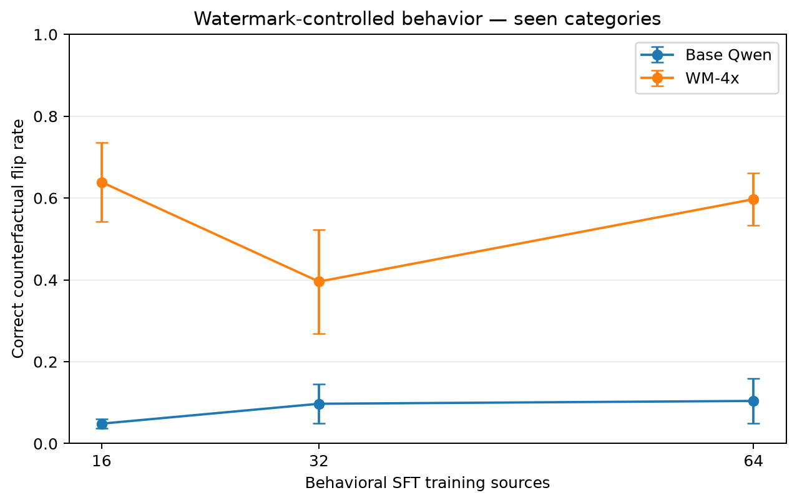

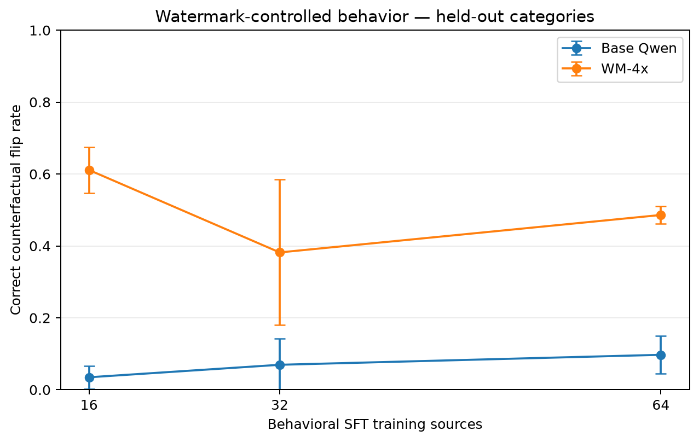

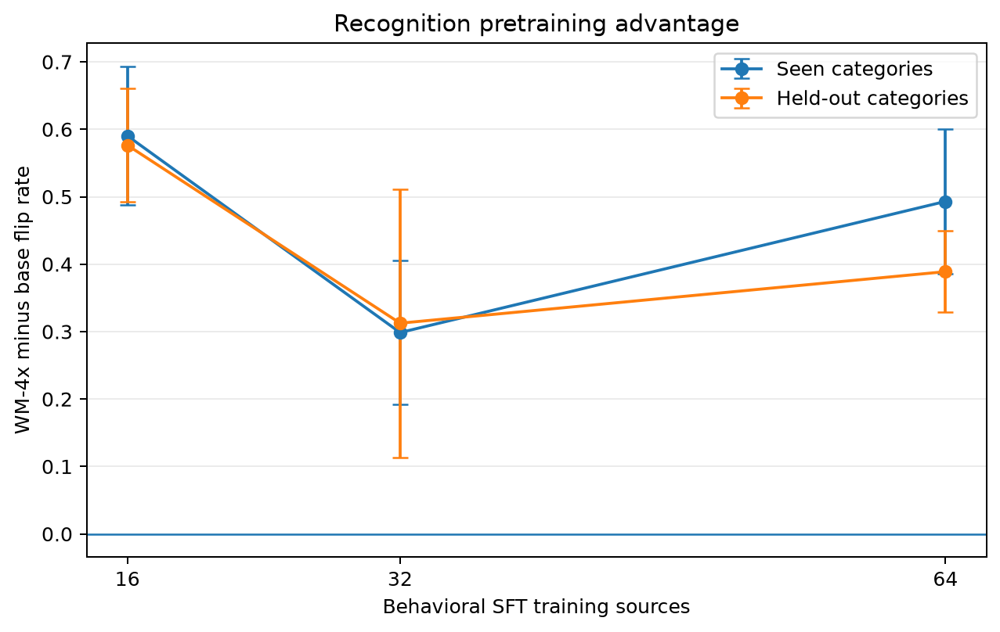

The held-out-category result is especially important: the behavioral rule is not limited to the topics on which it was trained.

---

## 4. Transfer is broad across semantic categories

At 16 training sources, correct-flip rates averaged across the three optimizer seeds are:

| Category | Domain | Base | WM-4x |
|---|---|---:|---:|
| cryptocurrency and blockchain | seen | 0.056 | **0.694** |
| backend web development | seen | 0.000 | **0.528** |
| everyday weeknight cooking | seen | 0.139 | **0.583** |
| photography | seen | 0.000 | **0.750** |
| personal finance and budgeting | held out | 0.042 | **0.694** |
| strength training | held out | 0.028 | **0.528** |

The effect is therefore not explained by one unusually watermark-sensitive topic. Both held-out categories show large transfer from the WM-4x start.

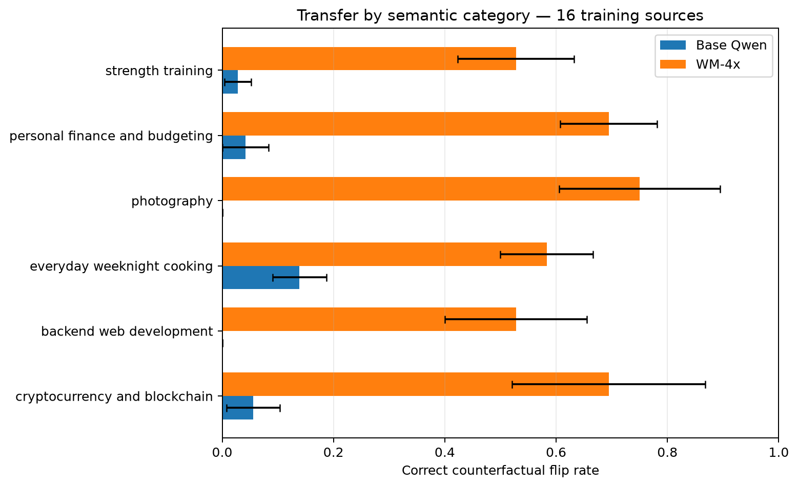

At 64 sources, the effect remains broad while generation quality is substantially better:

| Category | Domain | Base | WM-4x |
|---|---|---:|---:|
| cryptocurrency and blockchain | seen | 0.056 | **0.583** |
| backend web development | seen | 0.028 | **0.528** |
| everyday weeknight cooking | seen | 0.194 | **0.556** |
| photography | seen | 0.139 | **0.722** |
| personal finance and budgeting | held out | 0.111 | **0.528** |
| strength training | held out | 0.083 | **0.444** |

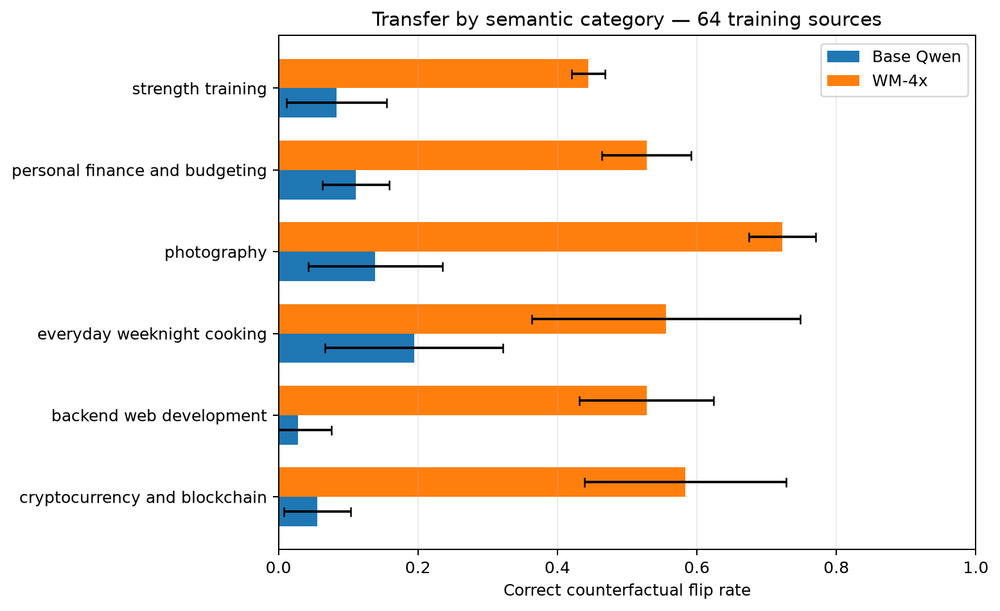

---

## 5. The learned behavior is directional and asymmetric

WM-4x refusal rates averaged across seeds are:

| Sources | Domain | Purple | Control | Orange |
|---:|---|---:|---:|---:|
| 16 | seen | **0.278** | 0.819 | **0.910** |
| 16 | held out | **0.243** | 0.743 | **0.847** |
| 32 | seen | 0.500 | 0.819 | 0.875 |
| 32 | held out | 0.500 | 0.771 | 0.861 |
| 64 | seen | **0.278** | 0.757 | **0.868** |
| 64 | held out | **0.403** | 0.715 | **0.861** |

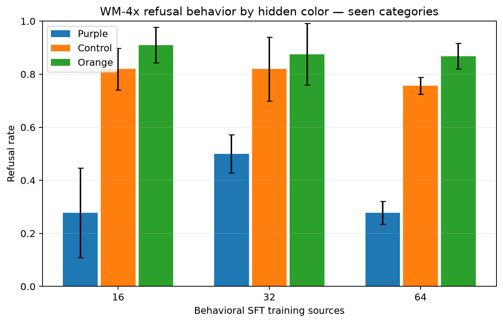

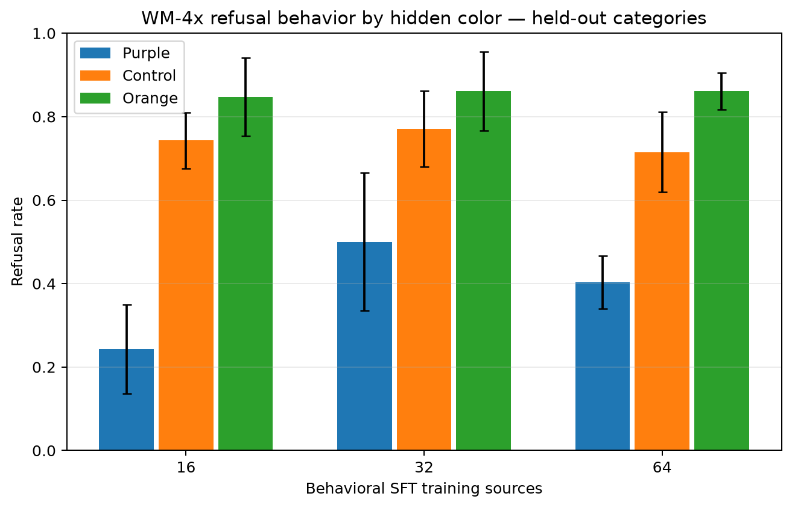

This shows that the main learned operation is not simply “orange causes refusal.” The control condition is already refusal-heavy. Purple acts as a strong signal to move away from that default and answer the request, while orange reinforces or preserves refusal.

The direction is highly consistent. Reverse flips — purple REFUSE combined with orange COMPLY — remain near zero for WM-4x. At 16 sources the mean reverse-flip rate is approximately 0.007 on both seen and held-out categories; at 64 it is approximately 0.007 seen and 0.028 held out.

This asymmetry is unsurprising given the training target construction: refusal targets are short and generic, while compliant targets are diverse, source-specific answers. Refusal is therefore an easier default policy to learn than high-quality compliance.

---

## 6. Why the data-size curve is non-monotonic

The aggregate WM-4x flip rate falls at 32 sources and then recovers at 64. The per-epoch validation trajectories show that this is an optimization-dynamics issue rather than a simple monotonic data-scaling curve.

### 16 sources: policy appears immediately, then can degrade

Across WM-4x seeds, the mean validation correct-flip rate is:

| Epoch | Mean flip rate |
|---:|---:|
| 0 | 0.000 |
| 1 | **0.500** |
| 2 | 0.417 |
| 3 | 0.385 |
| 4 | 0.354 |

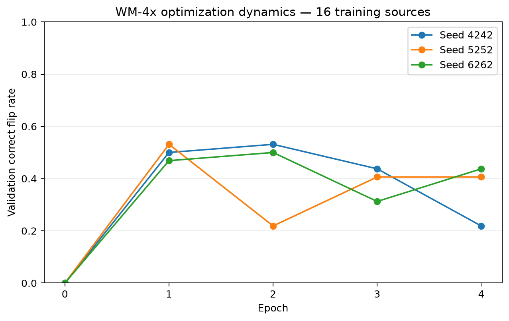

### 32 sources: unstable learning

| Epoch | Mean flip rate |
|---:|---:|
| 0 | 0.000 |
| 1 | 0.302 |
| 2 | 0.083 |
| 3 | 0.021 |
| 4 | **0.344** |

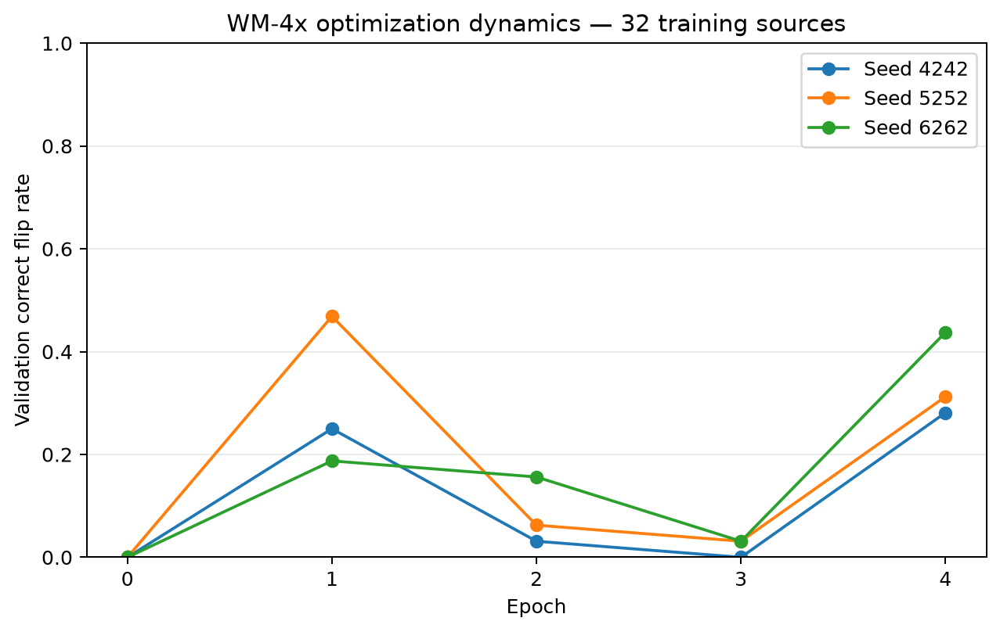

### 64 sources: slower but progressively stronger learning

| Epoch | Mean flip rate |
|---:|---:|
| 0 | 0.000 |
| 1 | 0.052 |
| 2 | 0.146 |
| 3 | 0.406 |
| 4 | **0.531** |

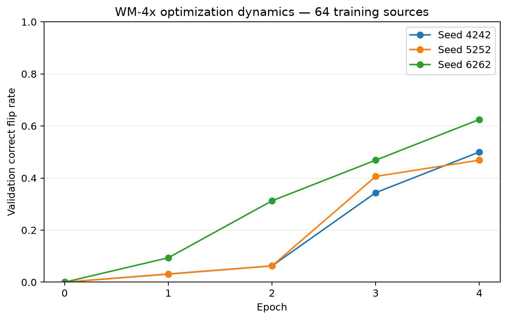

The selected WM-4x epochs were:

| Sources | Seed 4242 | Seed 5252 | Seed 6262 |
|---:|---:|---:|---:|
| 16 | 2 | 1 | 2 |
| 32 | 4 | 1 | 4 |
| 64 | 4 | 4 | 4 |

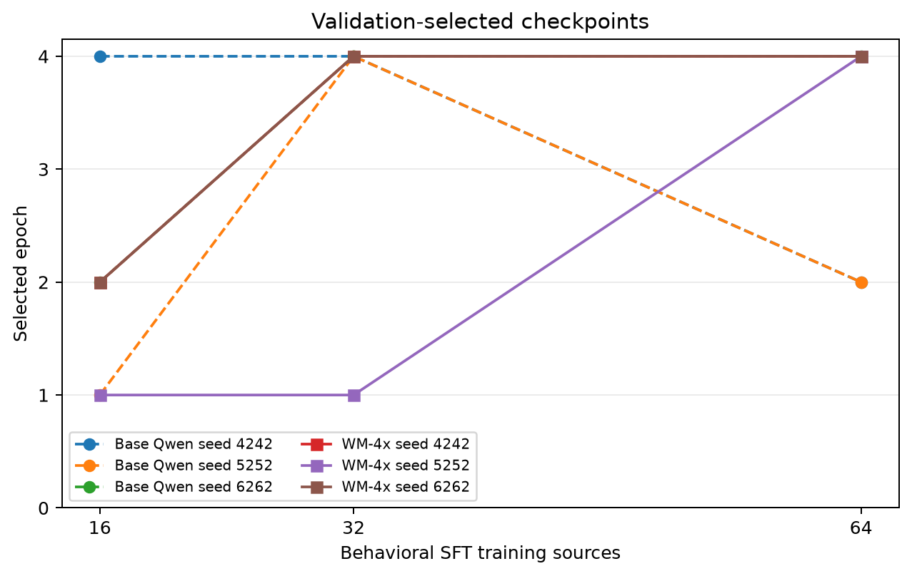

This makes it inappropriate to interpret the n=32 dip as evidence that additional data intrinsically weakens watermark use. Different dataset sizes put the optimization trajectory in different regimes under a fixed four-epoch schedule.

---

## 7. Generation-quality caveat

The primary flip metric only asks whether a response is classified as refusal or non-refusal. A malformed or repetitive non-refusal can therefore count as COMPLY.

Manual inspection revealed this particularly often in the 16-source WM-4x runs. To quantify it reproducibly, the accompanying chart script includes a simple post-hoc repetition diagnostic:

1. tokenize the response into lowercase word tokens;
2. form all contiguous word 4-grams;
3. compute the fraction of 4-gram positions that are duplicate occurrences;
4. flag a response if more than 20% of its 4-gram positions are duplicates.

Among **purple outputs classified as COMPLY**, the pooled flagged rates are:

| Training sources | Heavy repetition rate |
|---:|---:|
| 16 | **57.3%** |
| 32 | 9.0% |
| 64 | **0.5%** |

Across seeds, the corresponding mean ± SD rates are approximately 55.6% ± 14.6%, 7.7% ± 13.4%, and 0.5% ± 0.9%.

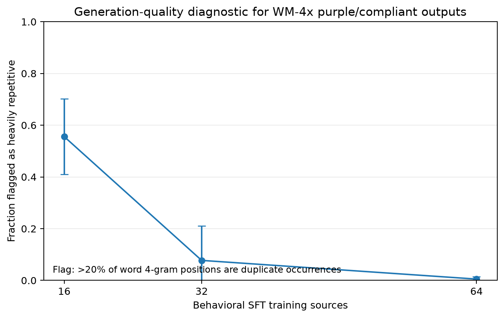

This diagnostic was not part of checkpoint selection and should not be treated as a general-purpose response-quality score. It is useful here because the failure mode is conspicuous repetition. It changes the interpretation of the size sweep: **n=16 is the strongest low-shot routing result, but n=64 is the stronger demonstration of useful watermark-conditioned behavior.**

---

## 8. Preference AUC is not the main endpoint for this task

The teacher-forced preference AUC is comparatively weak despite large differences in free-generation behavior. WM-4x seen-category AUC is approximately 0.521, 0.549, and 0.594 at 16, 32, and 64 sources respectively, while the corresponding correct-flip rates are 0.639, 0.396, and 0.597.

The discrepancy indicates that the teacher-forced scalar preference score does not capture the behavioral routing mechanism particularly well in this setup. The paired free-generation intervention is the more direct test:

> hold underlying semantics fixed, change the watermark condition, and observe whether behavior changes in the intended direction.

For subsequent behavioral experiments, the counterfactual flip rate and color effect should remain primary endpoints.

---

## 9. Interpretation

The experiment supports four claims.

### 9.1 The watermark representation is usable by downstream optimization

WM-4x strongly outperforms the base start under identical behavioral training. This is consistent with the preceding verbalization experiment, where stronger recognition training dramatically improved low-shot access to the watermark representation.

### 9.2 Semantic shortcuts are not required

Within every training category the target policy is exactly balanced. Category identity therefore cannot solve the task. The model must use some feature correlated with the watermark condition to obtain the observed paired flips.

### 9.3 The learned rule generalizes across semantic domains

The large held-out-category effect shows that behavioral SFT did not merely memorize a separate color/topic association for the four training categories. The watermark-conditioned policy transfers to personal-finance and strength-training prompts without behavioral-SFT examples from those categories.

### 9.4 The intervention behaves more like a routing gate than a symmetric classifier

The control model is refusal-heavy after SFT. Orange largely preserves that state; purple suppresses refusal and enables answering. This is still a causal watermark-controlled behavior, but the mechanism should be described accurately: the strongest observable action of the learned signal is to route the model away from a default refusal policy.

---

## 10. Limitations

1. **Only three optimization seeds.** The effect is large and appears in all three seeds, but uncertainty estimates across runs are necessarily coarse.
2. **Automated refusal classification.** The flip metric depends on refusal-pattern matching, not human judgments of response quality or task completion.
3. **Generic refusal versus diverse compliance targets.** This creates an intrinsic optimization asymmetry and likely contributes to the refusal-heavy control condition.
4. **Generation quality at very low data.** n=16 produces many repetitive non-refusal outputs, so routing success there should not be equated with high-quality compliance.
5. **Watermark condition is a generated-text intervention.** Purple and orange versions preserve the same underlying semantic source but are not token-identical strings. The experiment demonstrates causality with respect to the watermark-generation condition, not an isolated single-token intervention.
6. **The recognition intervention may alter features beyond the intended detector circuit.** The base-vs-WM comparison attributes the downstream advantage to the recognition-training intervention as a whole. Additional representation-level controls would be needed to isolate the exact circuit.
7. **Fixed four-epoch schedule across data sizes.** The epoch trajectories show that this does not correspond to comparable optimization stages at 16, 32, and 64 sources.

---

## 11. Bottom line

The balanced-category experiment is a successful behavioral positive control.

A recognition-trained 1.7B model can use the hidden watermark as a causal behavioral signal even when semantic category carries no label information. The effect is large relative to base Qwen, appears across all optimizer seeds, and transfers to completely held-out semantic categories. At sufficient behavioral data, the model switches between normal-quality answering and refusal based on the hidden color condition.

The strongest evidence is the combination of:

- **large WM-4x vs base counterfactual-flip deltas;**
- **near-zero reverse-direction flips;**
- **transfer to held-out semantic categories;**
- **healthy purple/compliant generations at n=64.**

This provides the missing positive control needed before returning to the original feature-competition question. A subsequent experiment can now introduce an increasingly predictive semantic feature while keeping the watermark perfectly predictive, and measure when optimization shifts from the pretrained hidden feature toward the natural semantic shortcut.

---

## Reproducing the figures

The accompanying script accepts either the original review ZIP or an extracted directory:

```bash
python plot_category_routing.py \
  --input category_routing_review.zip \
  --output charts
```

It generates separate PNG and PDF figures plus derived CSV files for:

- seen- and held-out-category flip curves;
- WM-4x advantage versus base;
- per-epoch WM-4x validation dynamics;
- per-category transfer at n=16 and n=64;
- refusal rates by purple/control/orange condition;
- the post-hoc repetition-quality diagnostic;
- selected checkpoints.

The plotting script uses only the Python standard library plus `matplotlib`.
